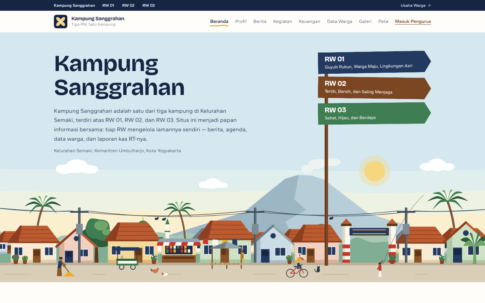
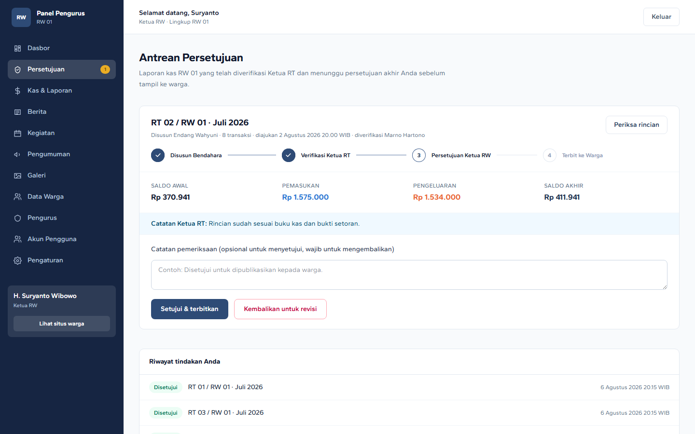
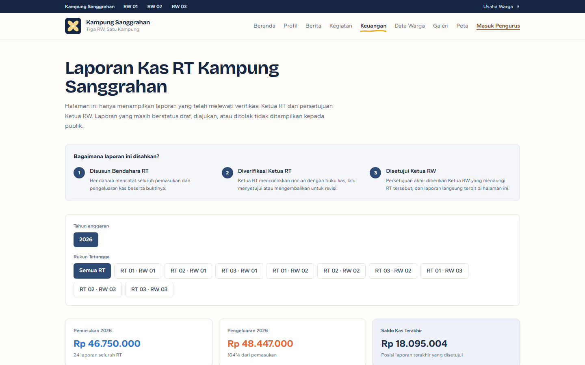
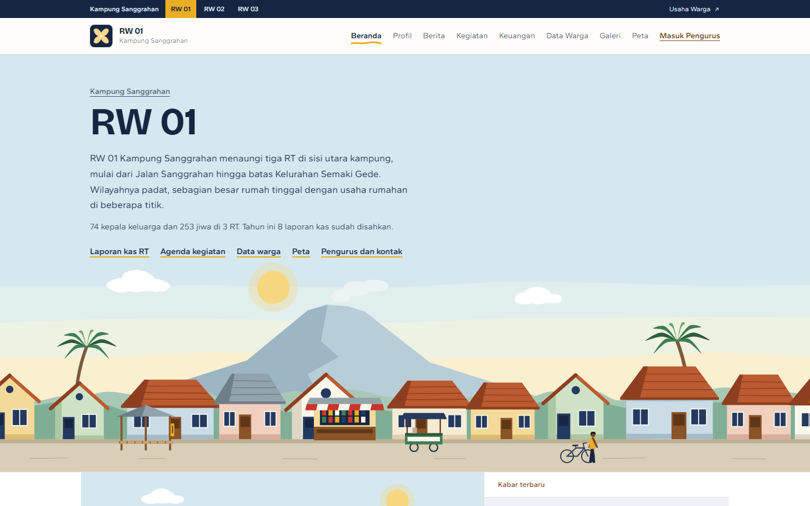
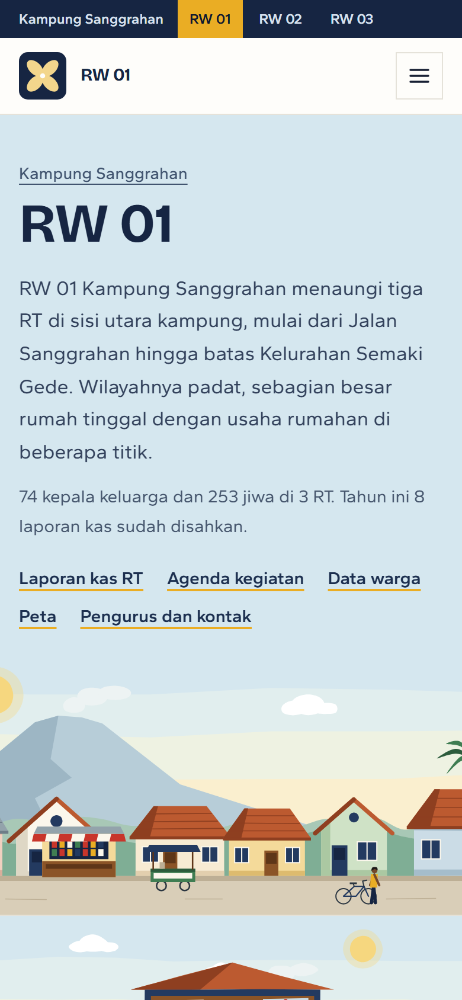

<div align="center">

# Website Kampung Sanggrahan

**Portal informasi warga sekaligus panel pengelolaan untuk pengurus — tiga RW
dalam satu situs.** Berita, agenda kegiatan, data kependudukan, galeri, dan
laporan keuangan kas RT dengan alur persetujuan berjenjang
**Bendahara RT → Ketua RT → Ketua RW**.

[**Lihat situsnya →**](https://profil-rw-sanggrahan.vercel.app)


RW 01, RW 02, dan RW 03 Kampung Sanggrahan, Kelurahan Semaki,
Kemantren Umbulharjo, Kota Yogyakarta.

</div>

---

## Daftar isi

1. [Tampilan](#tampilan)
2. [Tiga RW dalam satu situs](#tiga-rw-dalam-satu-situs)
3. [Mulai cepat](#mulai-cepat)
4. [Akun demo](#akun-demo)
5. [Alur persetujuan laporan keuangan](#alur-persetujuan-laporan-keuangan)
6. [Peran dan hak akses](#peran-dan-hak-akses)
7. [Halaman](#halaman)
8. [Struktur proyek](#struktur-proyek)
9. [Basis data](#basis-data)
10. [REST API publik](#rest-api-publik)
11. [Keputusan teknis](#keputusan-teknis)
12. [Pengujian](#pengujian)
13. [Penerapan](#penerapan)
14. [Situs warga yang bersebelahan](#situs-warga-yang-bersebelahan)
15. [Lisensi](#lisensi)

---

## Tampilan



| Antrean persetujuan Ketua RW | Laporan kas yang terbuka untuk warga |
| --- | --- |
|  |  |

| Laman satu RW | Tampilan ponsel |
| --- | --- |
|  |  |

---

## Tiga RW dalam satu situs

Kampung Sanggrahan terdiri atas RW 01, RW 02, dan RW 03. Ketiganya berbagi satu
kode program dan satu basis data, tetapi **tidak berbagi kewenangan**.

- **Beranda `/` adalah pintu masuk kampung**: tiga kartu RW, pengumuman yang
  berlaku lintas RW, dan tautan ke halaman gabungan. Isi sesungguhnya ada di
  laman tiap RW.
- **Tiap RW punya lamannya sendiri** di `/rw/1`, `/rw/2`, `/rw/3`, lengkap dengan
  profil, berita, kegiatan, galeri, data warga, dan laporan kasnya.
- **Halaman tingkat kampung** (`/berita`, `/kegiatan`, `/keuangan`, `/data-warga`,
  `/galeri`, `/profil`) menggabungkan ketiga RW dan mencantumkan asal RW pada
  tiap baris.
- **Konten boleh bertingkat kampung.** Berita, kegiatan, pengumuman, galeri, dan
  pengurus dengan `rwId` kosong dianggap milik kampung dan tampil di ketiga laman
  RW. Hanya administrator kampung yang boleh membuatnya.
- **Nomor RT hanya unik di dalam RW-nya.** RT 01 ada di RW 01, RW 02, dan RW 03
  sekaligus; kunci uniknya `(RW, nomor RT)`.

Batas kewenangan dijaga di sisi server, di `src/lib/otorisasi.ts`. Peran saja tidak
pernah cukup: Ketua RW 02 punya peran yang sama persis dengan Ketua RW 01, jadi
setiap pemeriksaan menanyakan dua hal — perannya tepat, **dan** barisnya berada di
RW yang sama dengan penggunanya.

> **Catatan data.** Seluruh warga, pengurus, berita, dan laporan kas di situs demo
> adalah data contoh hasil seed, bukan data warga sungguhan. Yang terverifikasi
> dari sumber publik hanyalah bahwa Kampung
> Sanggrahan terdiri atas RW 01, 02, dan 03, dan bahwa **RW 01 membawahi RT 01,
> RT 02, dan RT 03**. Jumlah RT di RW 02 dan RW 03 tidak dipublikasikan di mana
> pun, sehingga seed memberi keduanya tiga RT mengikuti pola RW 01 — itu **dugaan
> yang perlu dicocokkan ke pengurus**, bukan data resmi. Perbaiki dari
> `/admin/pengaturan`; tidak perlu mengubah kode.

---

## Mulai cepat

Butuh Node.js 20+ dan basis data PostgreSQL. Untuk pengembangan bisa memakai
Postgres lokal atau basis data gratis dari [Neon](https://neon.tech).

```bash
git clone https://github.com/AriesDjae/profil-rw-sanggrahan.git
cd profil-rw-sanggrahan
npm install

cp .env.example .env          # isi DATABASE_URL dan SESSION_SECRET
npx prisma migrate deploy     # menyiapkan tabel
npm run db:seed               # mengisi data contoh (sangat disarankan)

npm run dev                   # http://localhost:3000
```

Untuk produksi:

```bash
npm run build && npm start
```

Seed mengisi data contoh yang cukup untuk menilai seluruh alur: **3 RW, 9 RT,
±825 jiwa, 36 laporan kas** beserta transaksi dan jejak persetujuannya, ditambah
berita, kegiatan, pengumuman, dan album galeri.

### Berkas lingkungan (`.env`)

| Nama | Wajib | Keterangan |
| --- | --- | --- |
| `DATABASE_URL` | ya | Alamat PostgreSQL, mis. `postgresql://…?sslmode=require`. Di Neon, pakai connection string **pooled** untuk aplikasi. |
| `SESSION_SECRET` | ya | Kunci penanda tangan sesi, **minimal 32 karakter**. |
| `BLOB_READ_WRITE_TOKEN` | tidak | Bila diisi, unggahan disimpan ke Vercel Blob. Bila kosong, unggahan ditulis ke `public/unggahan` (dipakai saat lokal dan saat dipasang di VPS sendiri). |
| `NEXT_PUBLIC_URL_UMKM` | tidak | Alamat situs Registri Usaha Warga, ditautkan dari kop dan kaki halaman. Kosong = memakai bawaan di `src/lib/tautanLuar.ts`. |
| `NEXT_PUBLIC_SITE_URL` | tidak | Alamat kanonik untuk sitemap dan pratinjau tautan. Kosong = memakai bawaan di `src/lib/situs.ts`. |

---

## Akun demo

Seluruh akun hasil `npm run db:seed` memakai kata sandi **`sanggrahan123`**. Sandi
ini hanya untuk basis data lokal dan tidak berlaku di situs demo. Sebelum dipakai
sungguhan, ganti semua akun sekaligus dengan `npm run akun:ganti-sandi` (keterangan
ada di awal `prisma/ganti-sandi.ts`).

| Surel                              | Peran         | Kewenangan                                                        |
| ---------------------------------- | ------------- | ----------------------------------------------------------------- |
| `admin@sanggrahan.id`              | Administrator | **Satu-satunya akun lintas RW.** Akses penuh ketiga RW, akun, dan pengaturan kampung. |
| `ketuarw1@sanggrahan.id`           | Ketua RW      | Persetujuan akhir kas **RW 01 saja** + seluruh konten RW 01 + akun RW 01. |
| `sekretaris.rw1@sanggrahan.id`     | Sekretaris    | Berita, kegiatan, pengumuman, galeri, data warga, pengurus — **RW 01 saja**. |
| `ketuart01.rw1@sanggrahan.id`      | Ketua RT 01   | Verifikasi kas RT-nya + data warga RT-nya.                        |
| `bendaharart01.rw1@sanggrahan.id`  | Bendahara RT  | Menyusun dan mengajukan kas RT-nya.                               |

Ganti angka RW pada polanya untuk RW lain (`ketuarw2@…`, `sekretaris.rw3@…`), dan
nomor RT sampai RT 03 di tiap RW (`ketuart03.rw2@…`, `bendaharart02.rw3@…`).

Administrator kampung sengaja disimpan **tanpa RW** — kolom kosong itulah tanda
kewenangan lintas RW-nya.

---

## Alur persetujuan laporan keuangan

```
DRAFT ──ajukan──▶ DIAJUKAN ──verifikasi RT──▶ DIVERIFIKASI_RT ──setujui RW──▶ DISETUJUI
  ▲                   │                              │                            │
  └──────── DITOLAK ◀──┴──── kembalikan RT ───────────┴──── kembalikan RW ─────────┘
                                                      (Ketua RW juga dapat membuka
                                                       kembali laporan yang terbit)
```

Aturan yang ditegakkan di sisi server:

- Hanya **bendahara RT bersangkutan** (atau administrator) yang boleh membuat, mengubah,
  dan mengajukan laporan. Setelah diajukan, laporan terkunci dari penyuntingan.
- Laporan tanpa transaksi tidak dapat diajukan.
- Hanya **Ketua RT dari RT tersebut** yang dapat memverifikasi atau mengembalikan.
- Hanya **Ketua RW** yang memberi persetujuan akhir; tahap RW tidak dapat dilompati.
- Pengembalian **wajib disertai catatan** agar bendahara tahu bagian yang perlu direvisi.
- Hanya laporan berstatus `DISETUJUI` yang tampil di halaman publik `/keuangan`. Laporan
  yang dibuka kembali otomatis ditarik dari halaman publik.
- Setiap tindakan tercatat pada **jejak persetujuan** (siapa, kapan, catatan apa) dan
  ditampilkan terbuka kepada warga.

---

## Peran dan hak akses

Kolom **Lingkup** adalah yang membedakan situs ini dari situs satu RW: apa pun
perannya, seorang pengurus hanya berkuasa di dalam RW-nya.

| Peran         | Lingkup        | Kas & laporan             | Persetujuan       | Konten publik  | Data warga     | Akun & pengaturan            |
| ------------- | -------------- | ------------------------- | ----------------- | -------------- | -------------- | ---------------------------- |
| Administrator | Seluruh kampung| Semua RT ketiga RW        | Semua tahap       | Ya, + tingkat kampung | Semua RT | Ya, termasuk identitas kampung |
| Ketua RW      | Satu RW        | Lihat RW-nya              | Tahap RW, RW-nya  | RW-nya         | RW-nya         | Akun RW-nya, profil RW-nya   |
| Sekretaris RW | Satu RW        | Lihat RW-nya              | Tidak             | RW-nya         | RW-nya         | Tidak                        |
| Ketua RT      | Satu RT        | Lihat RT sendiri          | Tahap RT (RT-nya) | Tidak          | RT sendiri     | Tidak                        |
| Bendahara RT  | Satu RT        | Susun & ajukan RT sendiri | Tidak             | Tidak          | Tidak          | Tidak                        |

Yang **tidak** boleh dilakukan Ketua RW, dan diuji otomatis:

- membuka, menyetujui, atau menolak laporan kas RT milik RW lain;
- menyunting berita, kegiatan, pengumuman, galeri, atau pengurus RW lain;
- menyunting konten bertingkat kampung (yang tampil di ketiga RW);
- membuat atau mengubah akun di RW lain, atau mengangkat administrator kampung.

---

## Halaman

**Publik**

| Jalur                  | Isi                                                                     |
| ---------------------- | ----------------------------------------------------------------------- |
| `/`                    | **Pintu masuk kampung**: tiga kartu RW beserta angka pokoknya, pengumuman lintas RW, tautan ke halaman gabungan. |
| `/rw/[n]`              | **Beranda satu RW**: sambutan, pengumuman, kabar, agenda, ringkasan kas, tabel RT. |
| `/rw/[n]/profil`       | Sejarah, visi misi, pengurus, dan daftar RT milik RW itu.                |
| `/rw/[n]/berita`       | Berita RW itu, ditambah berita tingkat kampung.                          |
| `/rw/[n]/kegiatan`     | Agenda dan arsip kegiatan RW itu.                                        |
| `/rw/[n]/keuangan`     | Kas RT di RW itu saja.                                                   |
| `/rw/[n]/data-warga`   | Statistik kependudukan RW itu.                                           |
| `/rw/[n]/galeri`       | Album dokumentasi RW itu.                                                |
| `/berita`              | Berita ketiga RW, tiap kartu menyebut asal RW-nya.                       |
| `/kegiatan`            | Agenda gabungan ketiga RW.                                               |
| `/keuangan`            | Kas seluruh RT ketiga RW, penyaring tahun & RT, grafik arus kas.         |
| `/keuangan/[id]`       | Rincian transaksi, pengesahan, dan jejak persetujuan satu laporan.       |
| `/profil`              | Profil kampung dan pengurus tingkat kampung.                             |
| `/data-warga`          | Statistik kependudukan se-kampung.                                       |
| `/galeri`              | Album dari ketiga RW.                                                    |
| `/peta`                | Peta kampung dengan titik usaha warga, ditambah `/rw/[n]/peta` per RW.   |

Halaman detail (`/berita/[slug]`, `/kegiatan/[slug]`, `/galeri/[slug]`,
`/keuangan/[id]`) sengaja tidak digandakan per RW: satu tulisan punya satu alamat
agar tautan yang beredar di grup warga tidak bercabang. Asal RW-nya ditandai di
dalam halaman.

**Panel pengurus** (`/masuk` lalu `/admin`)

Dasbor · Antrean Persetujuan · Kas & Laporan · Berita · Kegiatan · Pengumuman ·
Galeri · Data Warga · Pengurus · Akun Pengguna · Pengaturan Situs.

---

## Struktur proyek

```
prisma/
  schema.prisma        Skema basis data
  seed.ts              Data contoh: 3 RW, 9 RT, ±825 jiwa, 36 laporan kas, berita, kegiatan
  gambar.ts            Memilih ilustrasi contoh dari judul (ditulis ke public/contoh)
  ilustrasi/           Ilustrasi potongan kertas: alat gambar, benda kampung, adegan
  buat-ilustrasi.ts    Menulis ilustrasi situs ke public/ilustrasi (npm run ilustrasi)
  ganti-sandi.ts       Mengganti sandi bawaan seluruh akun sekaligus
  migrations/          Riwayat skema, termasuk CHECK dan trigger di _perkuat_integritas
src/
  app/
    unggahan/[...jalur]/ Penyaji berkas unggahan pengurus (lihat catatan di bawah)
    api/v1/            REST API publik hanya-baca beserta spesifikasi OpenAPI
    (publik)/          Halaman untuk warga
      page.tsx           Pintu masuk kampung
      (daftar)/          Halaman daftar gabungan, satu kerangka muat
      rw/[rw]/           Laman tiap RW (memakai komponen isi yang sama)
    admin/             Panel pengurus (dilindungi sesi + peran)
      keuangan/aksi.ts Server action alur persetujuan
    masuk/             Halaman dan aksi otentikasi
    sitemap.ts, robots.ts, opengraph-image.tsx   Peta situs dan pratinjau tautan
    not-found.tsx, error.tsx, global-error.tsx   Halaman 404 dan halaman galat
  fonts/               Berkas font beserta lisensinya
  data/titik-usaha.json  Titik usaha warga, disalin dari registri Usaha Warga
  components/
    admin/             Sidebar, primitif formulir, tombol
    keuangan/          Stepper, jejak persetujuan, tabel transaksi
    grafik/            Grafik batang, batang ganda, piramida usia (SVG/CSS, tanpa pustaka)
    publik/            Header (dengan pemilih RW), footer, kartu berita, kartu kegiatan
      halaman/           Badan halaman yang dipakai bersama laman kampung dan laman RW
    ui/                Komponen tampilan bersama
  lib/
    db.ts              Klien Prisma
    sesi.ts            Sesi JWT pada cookie httpOnly
    otorisasi.ts       Pemeriksaan peran dan lingkup RW/RT — inti pemisahan antar-RW
    alurLaporan.ts     Perpindahan status laporan beserta jejaknya dalam satu transaksi
    pembatasMasuk.ts   Pembatas percobaan masuk yang disimpan di basis data
    rw.ts              Pembacaan daftar RW, penerjemah alamat /rw/<n>, penyegar laman RW
    keuangan.ts        Perhitungan kas dan tahapan persetujuan
    kueri.ts           Kueri bersama halaman publik
    unggah.ts          Penyimpanan berkas: Vercel Blob atau folder lokal
    gambar.ts          Pengecil foto: maks 1600px, WEBP, EXIF (termasuk GPS) dibuang
    tautanLuar.ts      Alamat situs Registri Usaha Warga
uji/
  alur-persetujuan.mjs Uji ujung-ke-ujung alur ACC (Playwright)
  qc-tampilan.mjs      QC tata letak & aksesibilitas lintas ukuran layar
  qc-fungsi.mjs        QC fungsionalitas seluruh modul panel pengurus
  crud-berita.mjs      Satu berita ditempuh dari tulis sampai hapus, termasuk batas antar-RW
  crud-kegiatan.mjs    Satu kegiatan dari dijadwalkan sampai masuk arsip lalu dihapus
  crud-pengumuman.mjs  Pengumuman tingkat RW dan tingkat kampung, beserta pemisahannya
  crud-galeri.mjs      Album dan foto, termasuk unggahan sungguhan yang benar-benar termuat
  crud-warga.mjs       Data warga: kerahasiaan identitas dan batas wilayah antar-RW
  integritas.mts       Aturan basis data: CHECK, trigger, dan pengajuan serentak
  api.mjs              Seluruh endpoint /api/v1
  seo-aksesibilitas.mjs  Sitemap, pratinjau tautan, status 404, CSP, dan papan ketik
  keamanan-masuk.mjs   Pengalihan setelah masuk, pembatas percobaan, header keamanan
docs/tangkapan/        Tangkapan layar README
```

### Basis data

Lima belas model di `prisma/schema.prisma`, dengan tiga aturan lingkup yang
dipegang seluruh skema:

- **`Rt` wajib milik satu `Rw`.** Nomor RT hanya unik di dalam RW-nya
  (`@@unique([rwId, nomor])`).
- **`User.rwId` kosong hanya untuk peran `ADMIN`** — administrator tingkat
  kampung. Peran lain wajib terikat satu RW; Ketua RT dan Bendahara RT
  dipersempit lagi ke satu RT.
- **`Warga` dan `LaporanKeuangan` tidak menyimpan `rwId`** — RW-nya dibaca lewat
  `Rt`, supaya tidak ada dua sumber kebenaran yang bisa berselisih.

| Kelompok | Model |
| --- | --- |
| Wilayah | `Rw`, `Rt` |
| Akun | `User`, `PercobaanMasuk` |
| Konten publik | `Berita`, `Kegiatan`, `Pengumuman`, `Album`, `Foto`, `Pengurus` |
| Kependudukan | `Warga` |
| Keuangan | `LaporanKeuangan`, `Transaksi`, `RiwayatPersetujuan` |
| Identitas situs | `Pengaturan` (baris tunggal, `id = 1`) |

Kolom `status` dan `peran` memakai `String`, bukan enum, agar nilainya terkunci
di satu tempat (`src/lib/konstanta.ts`). Nilai yang sah tetap dijaga `CHECK` di
basis data, jadi nilai baru perlu ditambahkan di konstanta sekaligus di migrasi.

#### Aturan yang dijaga basis data

Pemeriksaan di aplikasi bisa terlewat oleh skrip, konsol, atau bug. Aturan yang
menyangkut uang dan jejak audit karena itu ditaruh di PostgreSQL
(migrasi `20261101120000_perkuat_integritas`):

| Aturan | Cara kerja |
| --- | --- |
| Nilai harus sah | `CHECK` pada status, peran, jenis transaksi, bulan, tahun, dan jumlah transaksi di atas nol. |
| Laporan sah wajib lengkap | Laporan `DISETUJUI` wajib punya waktu persetujuan. |
| Transaksi terkunci selama proses | Trigger menolak tambah, ubah, dan hapus transaksi pada laporan di luar `DRAFT` dan `DITOLAK`. |
| Jejak audit tidak bisa ditulis ulang | Trigger menolak perubahan isi `RiwayatPersetujuan`. |
| Arsip tidak ikut terhapus | `ON DELETE RESTRICT` dari `LaporanKeuangan` dan `Warga` ke `Rt`. |

Perpindahan status memakai `pindahStatusLaporan` di `src/lib/alurLaporan.ts`.
Statusnya diperiksa di dalam `UPDATE`, dan status beserta riwayatnya ditulis dalam
satu transaksi. Bila dua pengurus menekan tombol bersamaan, hanya satu yang berhasil.

---

## REST API publik

API hanya-baca di `/api/v1` menyajikan data yang memang sudah tampil di situs.
Data warga perorangan, laporan yang masih berproses, dan berkas bukti transaksi
tidak punya jalur di sini. Spesifikasi OpenAPI ada di `/api/v1/openapi.json`.

| Metode dan alamat | Isi | Kueri |
| --- | --- | --- |
| `GET /api/v1/rw` | Daftar RW beserta RT-nya | |
| `GET /api/v1/berita` | Berita terbit | `rw`, `kategori`, `halaman`, `per_halaman` |
| `GET /api/v1/berita/{slug}` | Rincian berita | |
| `GET /api/v1/kegiatan` | Kegiatan terbit dan arsip | `rw`, `waktu`, `halaman`, `per_halaman` |
| `GET /api/v1/keuangan` | Ringkasan laporan kas yang disetujui | `rw`, `tahun`, `halaman`, `per_halaman` |
| `GET /api/v1/keuangan/{id}` | Rincian laporan beserta transaksinya | |

Jawaban daftar berbentuk `{ "data": [...], "meta": { "halaman", "per_halaman",
"total", "total_halaman" } }`. Galat selalu berbentuk
`{ "galat": { "kode", "pesan", "rincian" } }`. Kueri tidak sah dijawab 400, dan
laporan yang belum disetujui dijawab 404 seperti data yang tidak ada.

```bash
curl "https://profil-rw-sanggrahan.vercel.app/api/v1/keuangan?rw=1&tahun=2026&per_halaman=5"
```

---

## Keputusan teknis

- **Halaman publik disajikan dari cache.** Halaman rincian dibangun statis dengan
  ISR, dan panel memanggil `revalidatePath` setiap kali menyimpan, sehingga warga
  jarang memicu kueri ke basis data di Singapura.
- **CSP tanpa nonce.** Nonce mewajibkan setiap halaman dirender per permintaan dan
  mematikan cache di atas. Harganya, `'unsafe-inline'` tetap dibutuhkan untuk skrip
  sebaris buatan Next.js, sementara asal skrip, formulir, dan bingkai tetap dibatasi.
- **Kerangka muat dipasang sempit.** Di bawah `loading.tsx` tanggapan sudah terkirim
  sebelum halaman selesai, sehingga `notFound()` dijawab 200. Karena itu kerangka muat
  hanya membungkus halaman daftar. Laman RW diperiksa lebih dulu di layout-nya, dan
  panel memakai penanda pada menu, supaya status 404 untuk data di luar wilayah
  pengurus tidak berubah.
- **Font disimpan di repositori.** Build tidak bergantung pada Google Fonts, dan
  pemuat font Google di Turbopack 16.3.4 memang gagal pada proyek ini.
- **Identitas visual diambil dari Yogyakarta.** Warnanya dari batik gaya Yogyakarta:
  latar putih pethak, biru wedel, dan cokelat soga, ditambah kunyit sebagai penanda.
  Font teksnya Gantari, rancangan Lafontype dari Indonesia. Warga memilih RW lewat
  papan penunjuk jalan seperti di mulut gang, dan pengumuman tampil sebagai kertas
  di papan warga.
- **Ilustrasi dihitung dari kode, bukan gambar raster.** `prisma/ilustrasi` menyusun
  adegan bergaya potongan kertas: Merapi di utara, gapura, pos ronda, kabel listrik,
  angkringan, sampai bulu tangkis di gang. Pinggir guntingannya dihitung saat berkas
  dibuat, jadi hasilnya tetap path biasa tanpa filter. Adegan terbesar 19 KB, panorama
  39 KB, sebelum dikompresi. Adegannya dipilih dari judul kabar, jadi berita kerja bakti
  memang bergambar kerja bakti, dan pengurus bisa menggantinya dengan foto dari panel.
- **Peta dimuat saat terlihat.** Leaflet dan kepingan OpenStreetMap baru diminta ketika
  petanya hampir masuk layar, supaya warga yang hanya memilih RW tidak ikut menanggung
  bebannya. Titiknya berasal dari registri Usaha Warga, dan 25 dari 26 titik ditandai
  sebagai perkiraan karena memang belum diukur di tempat.
- **Aturan uang dijaga basis data.** Lihat
  [Aturan yang dijaga basis data](#aturan-yang-dijaga-basis-data).

---

## Pengujian

Dua belas berkas uji menjalankan aplikasi sungguhan, sepuluh di antaranya di
peramban lewat Playwright. Nyalakan server lebih dulu (`npm run dev`), lalu di
jendela lain:

| Perintah | Cakupan |
| --- | --- |
| `npm run uji:alur` | Alur ACC berjenjang: bendahara mengajukan, Ketua RT memverifikasi, Ketua RW menyetujui, laporan terbit, lalu ditarik saat dibuka kembali. Termasuk uji batas kewenangan antar-peran. |
| `npm run uji:tampilan` | Setiap halaman pada layar 390px, 768px, dan 1440px: galat konsol, permintaan gagal, gulir mendatar, gambar rusak, jumlah `h1`, label tombol, dan ukuran sasaran sentuh. |
| `npm run uji:fungsi` | CRUD seluruh modul panel (berita, kegiatan, pengumuman, galeri, warga, pengurus, akun, pengaturan), penolakan masukan tidak sah, dan dampaknya pada halaman publik. |
| `npm run uji:crud:berita` | Satu berita ditempuh utuh: ditulis pengurus RW 01, terbit di `/rw/1/berita` dan `/berita`, **tidak** muncul di `/rw/2` dan `/rw/3`, ditolak saat disunting pengurus RW 02, disunting pemiliknya, dijadikan draf lalu diterbitkan lagi, akhirnya dihapus. |
| `npm run uji:crud:kegiatan` | Satu kegiatan dijadwalkan sampai dihapus: penolakan waktu selesai yang mendahului waktu mulai, tampil di agenda RW 01 dan agenda kampung tetapi tidak di RW 02/03, langsung terlihat di beranda RW-nya, disunting, dijadikan draf, dipindah ke arsip, lalu dihapus. |
| `npm run uji:crud:pengumuman` | Dua tingkat pengumuman sekaligus: milik RW 01 (hanya tampil di `/rw/1`, **tidak** di beranda kampung) dan milik kampung (tampil di `/` sekaligus ketiga laman RW), ditambah nonaktifkan/aktifkan, tanggal berakhir yang menyembunyikan, dan batas kewenangan RW 02. |
| `npm run uji:crud:galeri` | Album dibuat, diisi dua foto sungguhan, tampil di galeri RW 01 tetapi tidak di RW 02/03, fotonya benar-benar termuat (bukan sekadar ada elemennya), diganti nama sehingga alamatnya berpindah — alamat lama harus berhenti menyajikan salinan usang — lalu foto dan albumnya dihapus. |
| `npm run uji:crud:warga` | Validasi NIK 16 digit dan NIK ganda, statistik publik RW 01 dan kampung ikut bertambah sementara RW 02 tidak, **identitas pribadi tidak muncul di enam halaman publik**, pengurus RW 02 ditolak melihat maupun menyunting warga RW 01 termasuk saat menyisipkan `rtId` milik RW 01 ke formulirnya. |
| `npm run uji:crud` | Menjalankan kelima uji CRUD di atas. |
| `npm run uji:integritas` | Aturan basis data: `CHECK`, trigger, dan 10 pengajuan serentak yang hanya boleh berhasil satu kali. Hanya mau berjalan terhadap `localhost`. |
| `npm run uji:api` | Seluruh endpoint `/api/v1`: bentuk jawaban, halaman, saringan RW, validasi kueri, dan data yang tidak boleh keluar. |
| `npm run uji:seo` | Sitemap, `robots.txt`, pratinjau tautan seperti yang dibaca WhatsApp, status 404 sungguhan, CSP yang benar-benar menolak skrip luar, font yang benar-benar terpakai, tautan lewati, penanda fokus, kerangka muat, dan peta yang baru dimuat saat terlihat. Pada `npm run dev`, setel `UJI_DEV=1`. |
| `npm run uji:masuk` | Pengalihan setelah masuk tidak bisa dibelokkan ke situs luar, pembatas percobaan masuk, dan header keamanan. |
| `npm run uji` | Menjalankan semuanya berurutan. |

Uji alur dan uji CRUD sekaligus menjaga pemisahan antar-RW: Ketua RT bernomor
sama dari RW lain, dan Ketua RW dari RW lain, harus sama-sama ditolak saat
membuka laporan yang bukan wilayahnya.

Bila server berjalan di alamat lain, setel `DASAR`, misalnya
`DASAR=http://localhost:3100 npm run uji`.

> Uji fungsi dan uji alur mengubah data, dan `.env` yang mengarah ke Neon akan ikut
> berubah. Arahkan `DATABASE_URL` ke PostgreSQL lokal dan kosongkan
> `BLOB_READ_WRITE_TOKEN` sebelum menjalankan server uji. Jalankan `npm run db:seed`
> setelahnya untuk mengembalikan data contoh.

GitHub Actions menjalankan `tsc`, ESLint, build, dan seluruh uji di atas terhadap
PostgreSQL sementara pada setiap push ke `master` dan setiap pull request.

---

## Penerapan

### Demo di Vercel

Vercel dipakai sebagai etalase MVP, region **Singapura** (`sin1`, disetel di
`vercel.json`). Proyek ini tidak tersambung ke GitHub di Vercel, jadi push tidak
mengubah situs; deploy dilakukan dengan `npx vercel deploy --prod`. Dua penyesuaian sudah dilakukan agar berjalan di sana, karena
sistem berkas Vercel bersifat hanya-baca dan sementara:

- **Basis data** memakai PostgreSQL (Neon), bukan berkas SQLite.
- **Unggahan berkas** otomatis dialihkan ke Vercel Blob bila
  `BLOB_READ_WRITE_TOKEN` tersedia; bila tidak, tetap ditulis ke folder lokal
  (`public/unggahan`) dan disajikan lewat rute `src/app/unggahan/[...jalur]`.
  Rute itu diperlukan karena Next.js mendaftar isi `public/` **saat build**,
  sehingga foto yang diunggah pengurus sesudahnya akan dijawab 404 oleh
  `next start` — terasa saat dipasang di VPS sendiri, tidak terasa di Vercel.
- **Gambar contoh** disimpan sebagai berkas statis di `public/contoh` dan ikut
  di-commit, sehingga tetap tampil tanpa perlu menulis berkas saat dijalankan.

Langkah deploy:

1. Buat basis data di Neon, salin connection string.
2. Jalankan `npx prisma migrate deploy` dari komputer, diarahkan ke basis data itu.
   Migrasi `20260907090000_kampung_tiga_rw` membuat ketiga RW sekaligus, jadi
   basis data yang tidak pernah di-seed pun langsung punya `/rw/1`, `/rw/2`, dan
   `/rw/3`.
3. Isi data contoh dengan `npm run db:seed`.
4. Di Vercel, impor repositori ini lalu isi environment variable `DATABASE_URL`,
   `SESSION_SECRET`, dan `BLOB_READ_WRITE_TOKEN`.

Migrasi skema **tidak** dijalankan saat build Vercel. Setelah mengubah
`schema.prisma`, jalankan `npm run db:deploy` dari komputer sambil diarahkan ke
basis data produksi, **sebelum** kode barunya di-deploy.

### Pemasangan sendiri (VPS)

Kode yang sama berjalan di server sendiri tanpa perubahan: cukup sediakan
PostgreSQL, kosongkan `BLOB_READ_WRITE_TOKEN` agar unggahan memakai folder
`public/unggahan`, lalu jalankan `npm run build && npm start` di belakang Nginx.

### Catatan lain

- **Cadangan.** Sertakan basis data dan folder `public/unggahan` dalam pencadangan rutin.
- **Keamanan.** Ganti `SESSION_SECRET` dan seluruh kata sandi demo sebelum dipakai warga.
  Jalankan di belakang HTTPS agar cookie sesi dikirim dengan atribut `secure`.
  Header keamanan dan CSP disetel di `next.config.ts`.
- **Data pribadi.** Halaman publik hanya menampilkan angka agregat; nama, NIK, dan
  alamat warga hanya dapat diakses dari panel pengurus sesuai lingkup perannya.
  Foto yang diunggah dikecilkan dan dibuang metadata EXIF-nya, termasuk titik GPS,
  sehingga alamat rumah warga tidak ikut terbawa.
- **Batas unggahan.** `next.config.ts` menyetel `serverActions.bodySizeLimit`
  ke 14 MB — sengaja di atas batas 12 MB di `src/lib/unggah.ts`, sebab pembungkus
  multipart menambah sedikit dari ukuran berkas aslinya.

---

## Situs warga yang bersebelahan

Urusan usaha warga punya situsnya sendiri:
**[Usaha Warga Sanggrahan](https://umkm-sanggrahan.vercel.app)** — registri UMKM
dan jasa warga RW 1 dan RW 3, dengan basis data dan panel pengurusnya sendiri
([repositori](https://github.com/AriesDjae/umkm-sanggrahan)).

Kedua situs berdiri terpisah tetapi melayani warga yang sama, jadi kop dan kaki
halaman keduanya saling menautkan. Alamat tujuannya ada di
`src/lib/tautanLuar.ts`, dan bisa ditimpa lewat env `NEXT_PUBLIC_URL_UMKM` tanpa
mengubah kode.

---

## Lisensi

Kode dan ilustrasi dirilis dengan [lisensi MIT](LICENSE). Font Bricolage Grotesque dan
Gantari berlisensi SIL Open Font License, salinannya ada di `src/fonts`. Data peta
&copy; kontributor [OpenStreetMap](https://www.openstreetmap.org/copyright).

---

<div align="center">
<sub>Dibangun swadaya untuk warga Kampung Sanggrahan, Semaki, Umbulharjo, Yogyakarta.</sub>
</div>
